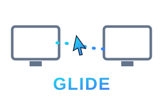

<p align="center">
  
</p>

<h1 align="center">Glide</h1>
<p align="center"><b>One mouse &amp; keyboard, every screen.</b><br>
A free, open-source software KVM for Windows.</p>

---

Glide lets one mouse and keyboard drive two (or more) Windows PCs over your
local network. Park the machines side by side, slide your cursor off the edge
of one screen, and keep going on the next — no KVM switch, no extra hardware.
Tap **Scroll Lock** anytime to jump control between machines or yank it back.

This is an original, clean-room implementation. No proprietary code. MIT
licensed — yours to use, fork, and ship.

## Install

Grab `glide.exe` from the [Releases](../../releases) page — no Python needed.
Put a copy on **both** PCs.

Or run from source:

```bash
pip install -r requirements.txt
python glide.py receiver        # on the second PC
python glide.py controller      # on the PC you sit at
```

## Use it

1. **Second PC (the one being controlled):** run `glide.exe`, choose
   **receiver**. It prints the port and waits.
2. **Your PC:** run `glide.exe`, choose **controller**, and enter the second
   PC's IP address (e.g. `192.168.1.42`).
3. Slide your cursor off the **right** edge of your screen — control crosses to
   the other machine. Your keyboard follows the cursor.
4. **Scroll Lock** toggles control manually and is the failsafe to grab your
   mouse back instantly.

Pick a different crossing edge with `--edge left|right|top|bottom`.

```bash
glide.exe controller --host 192.168.1.42 --edge right
```

## How it works

- The **controller** installs low-level mouse/keyboard hooks. While control is
  local, input passes through untouched. When the cursor hits the configured
  edge (or you hit Scroll Lock), Glide suppresses local input, pins the cursor
  to screen center, and streams relative motion, clicks, scroll, and keystrokes
  to the receiver.
- The **receiver** replays those events with the OS input APIs, so the remote
  machine behaves as if the mouse and keyboard were plugged into it.
- Transport is plain newline-delimited JSON over TCP (default port `24800`).

## Firewall

The first run, Windows will ask to allow Glide through the firewall on the
**receiver** — say yes for your private network. Both PCs must be on the same
LAN.

## Build the .exe yourself

```bash
build.cmd
```

Produces `dist\glide.exe`. Requires Python 3.9+.

## Roadmap

- [ ] Clipboard sharing between machines
- [ ] Multi-monitor-aware edge geometry
- [ ] More than two machines in a row
- [ ] Encrypted transport + pairing code
- [ ] System tray UI

PRs welcome.

## License

MIT — see [LICENSE](LICENSE).
